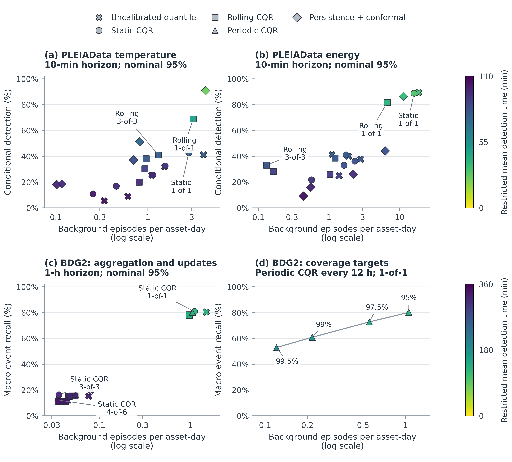
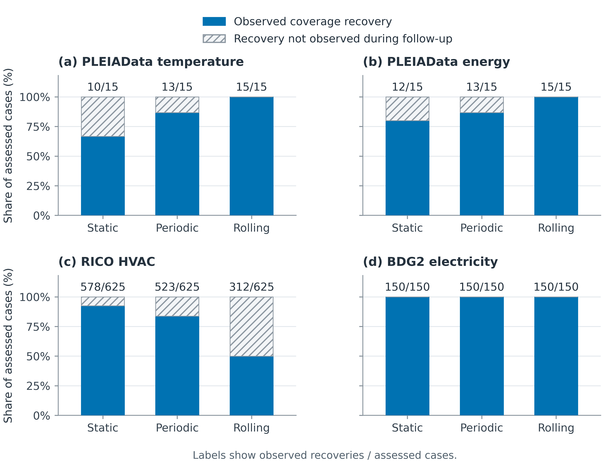

# JBE operational figures

Two manuscript figures generated directly from saved ConfoSense aggregate results.

## Figure previews

### Section 4.2: operational alert tradeoffs

[PNG](figures/section_4_2_alert_tradeoffs.png) | [PDF](figures/section_4_2_alert_tradeoffs.pdf) | [SVG](figures/section_4_2_alert_tradeoffs.svg)

### Section 4.3: coverage recovery

[PNG](figures/section_4_3_coverage_recovery.png) | [PDF](figures/section_4_3_coverage_recovery.pdf) | [SVG](figures/section_4_3_coverage_recovery.svg)

## Figure placement

| Suggested manuscript number | Section | File stem |
| --- | --- | --- |
| Figure 2 | 4.2 Operational Tradeoffs Across Alert Configurations | section_4_2_alert_tradeoffs |
| Figure 3 | 4.3 Robustness and Recalibration | section_4_3_coverage_recovery |

Keep Table 6 in Section 4.1 and Tables 7 and 8 in Section 4.2. The recovery figure can replace Table 10 in Section 4.3; retain Table 9 for calibration-contamination widths.

If the method overview remains Figure 1, the two existing interval figures become Figures 4 and 5 in Section 4.4, and the forecasting MAE figure becomes Figure 6 in Section 4.5. Update figure references throughout the manuscript.

## Files

- figures/*.png: 600-dpi images for insertion into Word.
- figures/*.pdf: vector figures with embedded fonts.
- figures/*.svg: vector figures with editable text.
- figures/*_data.csv: the exact plotted results and recovery counts.
- figures/CAPTIONS.md: complete manuscript captions.
- figures/VALIDATION.json: input integrity checks, point counts, numerical cross-checks and software versions.
- data/*.csv: original source tables, with no scientific results modified.
- SOURCE_MANIFEST.json: pinned commits, original Git blob hashes and SHA-256 checksums.
- generate_jbe_figures.py: standalone reproduction script.
- requirements.txt: Python dependencies.

## Reproduce offline

From this directory, run:

    python -m pip install -r requirements.txt
    python generate_jbe_figures.py

The script uses the included CSV files. It does not fit models, rerun experiments, recalculate event matches or infer missing measurements.

To download the identical pinned CSV files from public GitHub before plotting:

    python generate_jbe_figures.py --download

Optional output arguments:

    python generate_jbe_figures.py --output-dir figures --dpi 600

Every input is checked against both its original Git blob SHA and its SHA-256 checksum.

## What the figures show

### Section 4.2: alert tradeoffs

- Panels (a) and (b): the complete set of four PLEIAData interval controls and five aggregation rules for each target, using the combined numerical and availability stream. There are 20 saved aggregate results in each panel.
- Panel (c): 33 BDG2 nominal-95% configurations: three uncalibrated-quantile configurations and 30 CQR configurations.
- Panel (d): four BDG2 CQR nominal coverage targets with the same 12-hour update schedule and 1-of-1 alert rule.
- Marker colour represents restricted mean detection time, which includes missed events at the 110-minute PLEIAData limit or the 360-minute BDG2 limit.
- Marker shapes identify the interval control. Selected annotations identify aggregation rules or nominal coverage targets.
- Background episode rates use logarithmic horizontal axes.
- PLEIAData conditional detection and BDG2 macro event recall remain separate endpoints.
- PLEIAData summaries retain the original seed/context/stratum weighting. BDG2 results are means over three chronological test periods and five model seeds per period, using the same eligible observations across configurations.
- Each point is one saved aggregate result. The plotting script does not average different monitoring configurations together.
- The BDG2 nominal-95% results and later high-coverage extension retain their original provenance. The four nominal coverage levels use their recorded fitted quantile owners; the figure does not imply the identical fitted quantile model was used at different coverage targets.
- The figure describes the retained evaluations; it does not select a universal best configuration.

### Section 4.3: coverage recovery

- Four panels retain the separate building targets and RICO experimental runs.
- Blue segments show observed recovery. Hatched segments show cases without observed recovery before follow-up ended.
- Counts above bars are observed recoveries / assessed cases.
- Cases without observed recovery remain in the denominator and are right-censored; they are not assigned a recovery time.
- Recovery refers to rolling-window coverage returning within five percentage points of pre-disturbance coverage against the retained clean reference.
- A case is one building or experimental run within a chronological evaluation and model seed.
- Follow-up duration and group structure differ between settings. These are descriptive within-setting comparisons, not independent population replications or comparisons of physical sensor repair.
- No confidence intervals or significance tests have been added.

## Suggested manuscript references

For Section 4.2:

"Figure 2 illustrates how alert workload, detection and restricted mean detection time changed across monitoring configurations. The PLEIAData panels report conditional detection, while the BDG2 panels report macro event recall."

For Section 4.3, replace the sentence introducing Table 10 with:

"Figure 3 compares coverage recovery under static, periodic and rolling calibration. Labels indicate the number of cases meeting the recovery criterion out of the total assessed."

Complete captions are in figures/CAPTIONS.md.

## Existing related figures in the repository

The earlier report-figure branch already contains:

- report_figures/chapter4/figure_4_4_pleia_alert_tradeoffs.png
- report_figures/chapter4/figure_4_5_bdg2_alert_tradeoffs.png
- report_figures/chapter4/figure_4_7_recalibration_recovery.png

These are on branch review/chapter4-figures-20261003. The earlier BDG2 tradeoff figure predates the later CQR high-coverage extension. This package provides a new manuscript presentation including that extension.

## Source snapshots

The PLEIAData and recovery CSVs are pinned to:

    d65147ff22e6c079603eda1337630254796c8990

The combined BDG2 candidate summary and inventory are pinned to:

    55e74b51eeea917ebbec9a213d7054b968f53a8b

See SOURCE_MANIFEST.json for complete repository paths and checksums.

